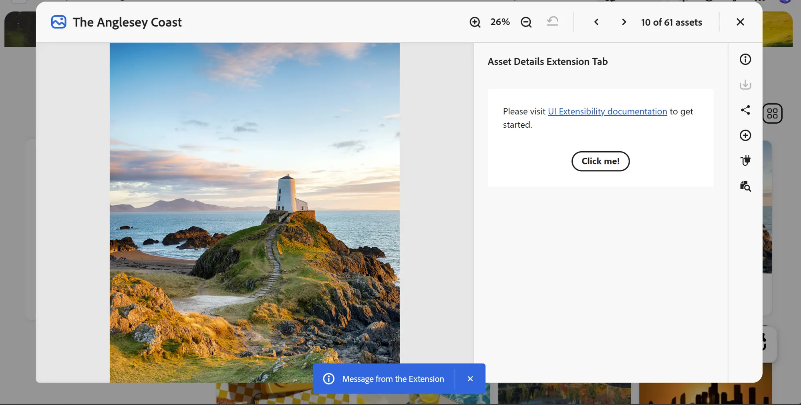

# Asset Details

The Asset Details interface in AEM Assets Content Hub shows detailed information about the selected asset.

Extensions should use the unified `aem/assets/contenthub/1` extension point to customize Asset Details. Asset Details capabilities are provided through the `assetDetails` namespace described below.

## Custom panels

The extensibility feature allows adding new panels and corresponding icon buttons to the Asset Details side rail using the [`assetDetails`](#assetdetails-namespace) namespace. Custom icons appear with the standard panel icons.



The host application fully manages UI interactions, including toggling the panel when a user selects its icon and updating the displayed panel when the current asset changes.

The host is also responsible for rendering the panel header.

The extension only declares the icon type, panel title, and URL for the custom panel content.

## API Reference

This API reference is divided into two parts: the API provided by AEM Assets Content Hub to the extension and the API provided by the extension to AEM Assets Content Hub.

### Host API Reference

In addition to the [Common APIs](../commons/index.md) provided by AEM Assets Content Hub to all extensions, the host application provides the following API specific to Asset Details.

#### `assetDetails.getCurrentAsset()`

**Description:** returns the ID of the asset currently displayed in Asset Details.

**Returns** (`string`): Current asset ID.

**Example:**

```jsx
const assetId = await guestConnection.host.assetDetails.getCurrentAsset();
```

### Extension API Reference

The extension definition object passed to the `register()` function defines the `assetDetails` namespace.

#### assetDetails namespace

The `assetDetails` namespace includes the following method:

- `getTabPanels()`

#### `assetDetails.getTabPanels()`

**Description:** returns an array of custom panel descriptors that the extension wants to add to Asset Details.

**Returns** (`array`): An array of custom panel descriptors, or an empty array if no custom panels should be added.

Each array element is a custom panel descriptor with the following properties:

| Property | Type | Description |
| --- | --- | --- |
| `id` | `string` | Panel ID, unique within the extension. |
| `tooltip` | `string` | Icon tooltip. |
| `title` | `string` | Custom panel title. |
| `icon` | `string` | Name of the [React Spectrum workflow icon](https://react-spectrum.adobe.com/icons.html#available-icons). |
| `contentUrl` | `string` | Relative route to the panel content. |

## Example of adding a custom panel

These code snippets demonstrate how the [AEM Assets Content Hub sample extension](https://github.com/adobe/aem-uix-examples/tree/main/aem-assets-contenthub-sample) creates a custom panel using the UIX SDK and adds it to Asset Details. The examples focus on the relevant code and omit some imports and other non-essential details.

The main application defines default routes for the `ExtensionRegistration` component and an `asset-details-extension-tab` route for the `PanelAssetDetailsExtensionTab` component. AEM Assets Content Hub loads this route when the user selects the custom panel icon:

```jsx
function App() {
  return (
    <Router>
      <ErrorBoundary onError={onError} FallbackComponent={fallbackComponent}>
        <Routes>
          <Route index element={<ExtensionRegistration />} />
          <Route exact path="index.html" element={<ExtensionRegistration />} />
          <Route
            path="asset-details-extension-tab"
            element={<PanelAssetDetailsExtensionTab />}
          />
        </Routes>
      </ErrorBoundary>
    </Router>
  );
}

export default App;
```

The `ExtensionRegistration` component initializes the extension by calling the `register()` function provided by `@adobe/uix-guest`. The object passed to `register()` declares the `assetDetails` namespace and its `getTabPanels()` method:

```jsx
function ExtensionRegistration() {
  const init = async () => {
    await register({
      id: 'extension-id',
      methods: {
        assetDetails: {
          getTabPanels() {
            return [
              {
                id: 'asset-details-extension-tab',
                tooltip: 'Asset Details Extension Tab',
                icon: 'Extension',
                title: 'Asset Details Extension Tab',
                contentUrl: '/#asset-details-extension-tab'
              }
            ];
          }
        }
      }
    });
  };

  init().catch(console.error);

  return <Text>IFrame for integration with Host (Content Hub)...</Text>;
}

export default ExtensionRegistration;
```

The `PanelAssetDetailsExtensionTab` component renders the custom panel content. It uses the `attach()` function provided by `@adobe/uix-guest` to establish a connection with AEM Assets Content Hub. The component then uses this connection to display a toast message when the user selects the button:

```jsx
export default function PanelAssetDetailsExtensionTab() {
  const [guestConnection, setGuestConnection] = useState();

  useEffect(() => {
    (async () => {
      const connection = await attach({id: 'extension-id'});
      setGuestConnection(connection);
    })();
  }, []);

  function displayToast(variant, message) {
    guestConnection.host.toast.display({variant, message});
  }

  return (
    <Provider theme={defaultTheme} height="100vh">
      <View backgroundColor="gray-50" padding="size-300">
        <Flex justifyContent="center" marginTop="size-400">
          <ButtonGroup>
            <Button
              variant="primary"
              onPress={() => displayToast('neutral', 'Message from the Extension')}
            >
              Click me!
            </Button>
          </ButtonGroup>
        </Flex>
      </View>
    </Provider>
  );
}
```

Panel content can also use `assetDetails.getCurrentAsset()` to retrieve the current asset ID:

```jsx
const assetId = await guestConnection.host.assetDetails.getCurrentAsset();
```

See the complete [registration component](https://github.com/adobe/aem-uix-examples/blob/main/aem-assets-contenthub-sample/src/aem-assets-contenthub-1/web-src/src/components/ExtensionRegistration.js) and [custom panel component](https://github.com/adobe/aem-uix-examples/blob/main/aem-assets-contenthub-sample/src/aem-assets-contenthub-1/web-src/src/components/PanelAssetDetailsExtensionTab.js) in the sample application.