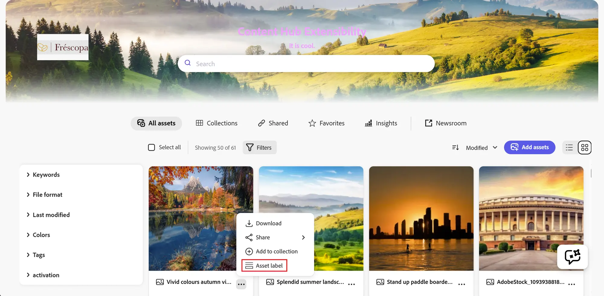
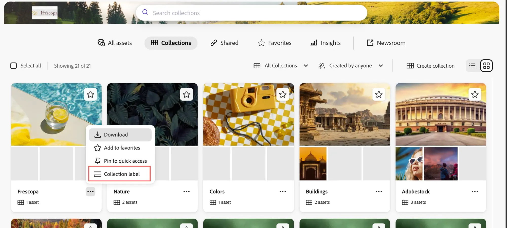

# Card Actions

AEM Assets Content Hub offers the ability to add custom actions to Asset Cards and Collection Cards.

An Asset Card represents an asset in Content Hub. A Collection Card represents a collection. Each card provides an action menu associated with that resource.

Extensions should use the unified `aem/assets/contenthub/1` extension point to customize Card Actions.

## Custom Asset Card and Collection Card actions

This extensibility feature allows context-aware customization of the action menu associated with an Asset Card or Collection Card.

Using the `card` namespace, custom actions can be added after the built-in actions. A custom action can adapt its label, icon, and behavior to the current context and selected resource.

In this example, a custom **Asset label** action is added to an Asset Card action menu:



In this example, a custom **Collection label** action is added to a Collection Card action menu:



## API Reference

This API reference is divided into two parts: the API provided by AEM Assets Content Hub to the extension and the API provided by the extension to AEM Assets Content Hub.

### Host API Reference

Card Actions can use the [Common APIs](../commons/index.md) provided by AEM Assets Content Hub to all extensions. The host communicates the current context and selected resource through the `card` extension API callbacks described below.

### Card context

AEM Assets Content Hub supports Card Actions in two contexts. The current context is communicated to the extension APIs so custom code can adapt to the current area of Content Hub.

- **Asset Cards:** The action context is `assets`. When an action is selected, the resource type is `asset`.
- **Collection Cards:** The action context is `collections`. When an action is selected, the resource type is `collection`.

Asset Cards report the `assets` context in the main assets view, within collections, and in link shares. Only Collection Cards report the `collections` context.

### Extension API Reference

The extension definition object passed by the extension to the `register()` function defines the `card` namespace.

The methods in this namespace provide the capabilities to:

- Add custom actions to Asset Cards and Collection Cards.
- Handle user interaction with a custom Card Action.

#### card namespace

The `card` namespace includes these two methods:

- `getActionButtons(actionContext)`
- `onActionClick(resourceType, buttonId, resourceId, actionContext)`

#### `card.getActionButtons(actionContext)`

**Description:** returns an array of custom action descriptors or an empty array if no custom actions should be added in the specified context.

**Parameters:**

- `actionContext` (`object`): Object representing the current Card Action context.
  - `context` (`string`): Current context. Possible values are `assets` and `collections`.

**Returns** (`array`): An array of custom action descriptors, or an empty array if no custom actions should be added.

Each array element is a custom action descriptor with the following properties:

- `id` (`string`): Action ID, unique within the extension.
- `label` (`string`): Custom action title.
- `icon` (`string`): Name of the [React Spectrum workflow icon](https://react-spectrum.adobe.com/icons.html#available-icons).

**Example:**

```jsx
card: {
  getActionButtons({context}) {
    return [
      {
        id: 'customId',
        label: context === 'collections' ? 'Collection action' : 'Asset action',
        icon: 'Form'
      }
    ];
  }
}
```

#### `card.onActionClick(resourceType, buttonId, resourceId, actionContext)`

**Description:** handles activation of a custom action for the selected Asset Card or Collection Card.

**Parameters:**

- `resourceType` (`string`): Selected resource type. Possible values are `asset` and `collection`.
- `buttonId` (`string`): ID of the activated custom action.
- `resourceId` (`string`): ID of the selected asset or collection.
- `actionContext` (`object`): Object representing the current Card Action context.
  - `context` (`string`): Current context. Possible values are `assets` and `collections`.

**Example:**

```jsx
async onActionClick(resourceType, buttonId, resourceId, {context}) {
  if (buttonId === 'customId') {
    // Handle the action for the selected resource.
  }
}
```

## Examples

These code snippets demonstrate how the [AEM Assets Content Hub sample extension](https://github.com/adobe/aem-uix-examples/tree/main/aem-assets-contenthub-sample) adds a custom action to Asset Cards and Collection Cards and opens a custom dialog when the action is selected. The examples focus on the relevant code and omit some imports and other non-essential details.

The `ExtensionRegistration` component initializes the extension registration process by calling the `register()` function provided by the `@adobe/uix-guest` library.

The object passed to `register()` describes the extension and its capabilities. In particular, it declares that the extension uses the `card` namespace and its `getActionButtons()` and `onActionClick()` methods:


```jsx
function ExtensionRegistration() {
  const init = async () => {
    const guestConnection = await register({
      id: 'extension-id',
      methods: {
        card: {
          getActionButtons() {
            return [
              {
                id: 'customId',
                label: 'Custom label',
                icon: 'Form'
              }
            ];
          },
          async onActionClick(resourceType, buttonId, resourceId) {
            if (buttonId === 'customId') {
              await guestConnection.host.modal.openDialog({
                title: 'Custom Dialog',
                contentUrl: `/#card-action-modal?resourceId=${encodeURIComponent(resourceId)}&resourceType=${encodeURIComponent(resourceType)}`,
                type: 'modal',
                size: 'M'
              });
            }
          }
        }
      }
    });
  };

  init().catch(console.error);

  return <Text>IFrame for integration with Host (Content Hub)...</Text>;
}

export default ExtensionRegistration;
```

### Example of context-aware Card Actions

The `context` value can be used to return different actions for Asset Cards and Collection Cards. In this example, the extension adds one action only to Asset Cards and a different action only to Collection Cards:

```jsx
card: {
  getActionButtons({context}) {
    if (context === 'assets') {
      return [
        {
          id: 'assetAction',
          label: 'Asset action',
          icon: 'Image'
        }
      ];
    }

    if (context === 'collections') {
      return [
        {
          id: 'collectionAction',
          label: 'Collection action',
          icon: 'Folder'
        }
      ];
    }

    return [];
  }
}
```

### Example of handling a Card Action

The sample passes the selected `resourceId` and `resourceType` to a custom dialog through the dialog URL. The dialog route reads those values, connects to AEM Assets Content Hub using `attach()`, and can close itself using the Modal API:

```jsx
export default function CardActionModal() {
  const [guestConnection, setGuestConnection] = useState(null);
  const [resource, setResource] = useState(null);

  useEffect(() => {
    (async () => {
      const params = new URLSearchParams(window.location.hash.split('?')[1] || '');
      setResource({
        resourceId: params.get('resourceId'),
        resourceType: params.get('resourceType')
      });

      const connection = await attach({id: 'extension-id'});
      setGuestConnection(connection);
    })();
  }, []);

  return (
    <Provider theme={defaultTheme} height="100vh">
      <View padding="size-400">
        <Heading level={3}>Custom Dialog</Heading>
        <Text>Resource Type: {resource?.resourceType}</Text>
        <Text>Resource ID: {resource?.resourceId}</Text>
        <Button
          variant="accent"
          onPress={() => guestConnection?.host.modal.closeDialog()}
        >
          Close
        </Button>
      </View>
    </Provider>
  );
}
```

See the complete [registration component](https://github.com/adobe/aem-uix-examples/blob/main/aem-assets-contenthub-sample/src/aem-assets-contenthub-1/web-src/src/components/ExtensionRegistration.js) and [Card Action dialog component](https://github.com/adobe/aem-uix-examples/blob/main/aem-assets-contenthub-sample/src/aem-assets-contenthub-1/web-src/src/components/CardActionModal.js) in the sample application.