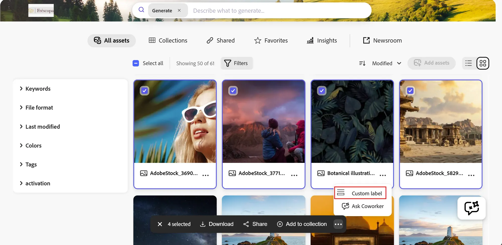

# Selection Bar

**Selection Bar** is the bar with actions that appears when one or more assets or collections in AEM Assets Content Hub are selected.

The Selection Bar API adds commands that operate on multiple selected assets. Content Hub displays these commands when the user selects assets in a supported browsing surface.

In this example, a custom action is added to the Selection Bar after the built-in actions:



## Register Selection Bar actions

Implement `selectionBar.getActionButtons(actionContext)` to return action buttons. The action context contains the current surface and selected resources:

```js
{
  context: 'assets',
  resourceSelection: {
    resources: [{id: 'urn:aaid:aem:...'}]
  }
}
```

Implement `selectionBar.onActionClick(buttonId, assetIds)` to handle a selected command.

```jsx
const guestConnection = await register({
  id: 'extension-id',
  methods: {
    selectionBar: {
      getActionButtons({resourceSelection}) {
        if (resourceSelection.resources.length === 0) {
          return [];
        }

        return [
          {
            id: 'copy-urls',
            label: 'Copy URLs',
            icon: 'Link'
          }
        ];
      },
      async onActionClick(buttonId, assetIds) {
        if (buttonId !== 'copy-urls') {
          return;
        }

        await guestConnection.host.modal.openDialog({
          title: 'Copy asset URLs',
          contentUrl: `/#copy-urls?assetIds=${encodeURIComponent(JSON.stringify(assetIds))}`,
          type: 'modal',
          size: 'M'
        });
      }
    }
  }
});
```

Selection Bar buttons use the same `id`, `label`, and `icon` properties as card action buttons. Content Hub passes `onActionClick()` an array containing the IDs of the selected assets.

See the [sample registration component](https://github.com/adobe/aem-uix-examples/blob/main/aem-assets-contenthub-sample/src/aem-assets-contenthub-1/web-src/src/components/ExtensionRegistration.js) and [sample Selection Bar dialog](https://github.com/adobe/aem-uix-examples/blob/main/aem-assets-contenthub-sample/src/aem-assets-contenthub-1/web-src/src/components/SelectionBarModal.js) for a complete implementation.